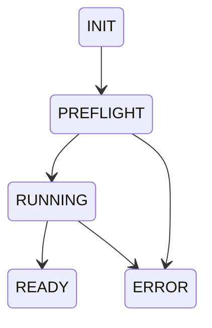
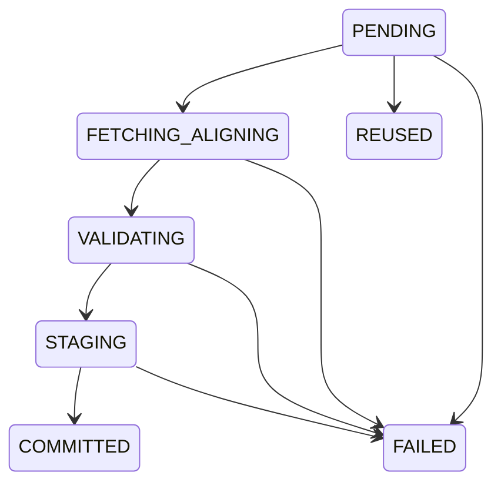

# Reefactor research expansion — reviewed 2 November 2026

## Outcome and scope

The feature registry contains **36 gridded source fields**: 30 daily fields,
four monthly chemistry fields and two static context fields. One of the 36,
NOAA DHW, is an algebraically derived reference rather than an independent
driver. Eleven additional derived features are calculated locally when their
dependencies exist. Five survey context fields and observed bleaching percent
come from a single versioned field-observation dataset.

This is a defensible expansion of the project's heat-transport vision. More
columns do not automatically mean more causal information. Reanalysis and
hindcast fields are estimates, not reef-scale instrument observations; shared
model forcing also means the fields are not statistically independent.

The code and tests implement ingestion, conservative harmonization, fault
recovery, sparse label preparation, lazy window loading, a multivariate SST
forecaster, forced heat-budget PINN training, and a salinity-budget loss. The
salinity loss is available for a future salinity prediction head; the supplied
trainer predicts SST. A trained, validated biological bleaching model is a
later milestone, not an outcome demonstrated by this branch.

## Current project audit

The original configuration requests GBR, 2017-02-13 through 2018-12-31, with SST,
DHW, eastward current and northward current. Its current source begins in 2017,
which truncates the shared history. Although its training store is lazy, the
original ingestion retains loaded monthly chunks in a list and concatenates
the entire request in memory. Training reads full maps before cropping.

The old FSM assigns states without checking legal transitions. It has no
bounded concurrent scheduler, Docker environment or DuckDB/Polars journal.
The constant 5.5 km spacing and 0.05-degree interpolation of 0.25-degree currents
do not create genuine 5 km current observations. Its forecast-horizon currents
are future reanalysis: useful for retrospective regularization, unavailable
as actual future observations at issuance. Existing alert agreement metrics
evaluate thermal-stress thresholds, not independently observed bleaching.

The old documentation mixes 2017–2018, 2017–2023 and other experiment windows;
the checked-in config is the reliable definition of the legacy experiment.
Legacy MMM recovery assumes the downloaded HotSpot is an unclipped anomaly;
do not transfer that assumption to another product or mirror without checking
metadata and testing time invariance. Prefer NOAA's official static climatology.

The new implementation lives under `src/reef`, uses `configs/research.yaml`,
and never writes into the legacy training store or checkpoint directory.

## Sources and parameter inventory

Four environmental product families cover the core inventory. Daily, monthly
and static BGC endpoints count as one product family but three datasets. There
are six gridded endpoints and one additional observational-label dataset.
Mirrors and Google hosting do not count as new independent scientific sources.

| Product family | Fields | Native support | Access and evidence |
|---|---:|---|---|
| [NOAA CRW CoralTemp v3.1](https://coralreefwatch.noaa.gov/product/5km/index_5km_sst.php) | 2 | 0.05°, daily; satellite foundation SST analysis | Public PacIOOS ERDDAP; live axis checked |
| [Copernicus GLORYS12](https://data.marine.copernicus.eu/product/GLOBAL_MULTIYEAR_PHY_001_030/description) | 6 | 1/12°, daily; assimilative ocean reanalysis | Public catalog and anonymous HTTPS Zarr |
| [ECMWF ERA5 single levels](https://cds.climate.copernicus.eu/datasets/reanalysis-era5-single-levels?tab=overview) | 16 | 0.25°, hourly; atmospheric reanalysis | CDS subset adapter; free account/licence required |
| [Copernicus BGC hindcast](https://data.marine.copernicus.eu/product/GLOBAL_MULTIYEAR_BGC_001_029/description) | 12 | 0.25°; 6 daily + 4 monthly + 2 static | Public catalog and anonymous HTTPS Zarr; no assimilation |
| [BCO-DMO field observations v2](https://www.bco-dmo.org/dataset/773466) | target + 5 contexts | Sparse surveys; 1980–2020 | CC BY 4.0, version DOI 10.26008/1912/bco-dmo.773466.2 |

The machine-readable registry is `src/reef/catalog.py`; `python run_research.py
catalog` exports native names, canonical names, units, reducers and bounds.

| Group | Included fields | Purpose |
|---|---|---|
| NOAA, daily | sea_surface_temperature; degree_heating_weeks | Observed/analysed SST target and NOAA thermal-stress reference. DHW is not an independent cause or a biological label. |
| GLORYS, daily | ocean_temperature (`thetao`); salinity (`so`); water_u (`uo`); water_v (`vo`); sea_level (`zos`); mixed_layer_depth (`mlotst`) | Ocean transport, freshwater stress, mixing depth and circulation context. Only the near-surface model level is selected. |
| ERA5, hourly → daily | wind_u; wind_v; air_temperature; dewpoint; surface_pressure; mean_sea_level_pressure; cloud_fraction | Atmospheric forcing, humidity and mixing context. |
| ERA5, hourly → daily | shortwave_down; longwave_down; shortwave_net; longwave_net; latent_heat_flux; sensible_heat_flux; precipitation; evaporation; uv_down | Radiative, turbulent and freshwater forcing. Mean flux products avoid accumulation-reset ambiguity. |
| BGC, daily | chlorophyll; nitrate; phosphate; silicate; oxygen; primary_production | Nutrient, productivity and oxygen context; these are model estimates with important coastal uncertainty. |
| BGC, monthly | iron; phytoplankton_carbon; ph; surface_pco2 | Slow chemistry context. No claim of daily observations. |
| BGC, static | bathymetry; ocean_fraction | Coarse model bathymetry and area-aggregated model ocean mask. Neither resolves a particular shallow reef or coral colony. |
| Survey context | Depth_m; Distance_to_Shore; Exposure; Turbidity; Cyclone_Frequency | Site context retained with survey provenance. Historical turbidity/cyclone summaries require a separate causal-availability audit before being used predictively. |

Surface pCO2 is **Pa**, not micro-atmospheres. Nutrients and oxygen use
mmol m^-3; chlorophyll uses mg m^-3. Practical salinity uses 1e-3. Temperature
is Celsius for the ocean and kelvin for atmospheric thermodynamic fields.
Source unit strings are checked before harmonization; unrecognized units fail.

Derived features: wind speed, current speed, relative humidity, net heat flux,
freshwater flux, HotSpot, recomputed DHW, mixed-layer heat tendency, sine/cosine
seasonality, and satellite-minus-model near-surface temperature difference.
The last difference is a product/representation mismatch indicator, **not a
measurement of vertical stratification**. Official MMM must be supplied to
derive HotSpot/DHW; no full 84-day history means no valid recomputed DHW.

NOAA DHW coarsened from its native grid is a reference-area average. Computing
DHW after coarsening SST is a different nonlinear operation; compare their
differences explicitly rather than calling them interchangeable.

## Coverage and common ground

| Component | Reviewed temporal coverage | Interpretation |
|---|---|---|
| CoralTemp scientific product | 1985-01-01 onward | Product documentation |
| Actual `dhw_5km` mirror | **1985-04-01 to 2026-10-29**, noon UTC timestamps | Live metadata; not the January product start |
| GLORYS daily, version 202311 | **1993-01-01 to 2026-09-22** | Live Copernicus per-variable catalog axes |
| BGC daily, version 202406 | **1993-01-01 to 2026-08-31** | Live per-variable catalog axes |
| BGC monthly, version 202406 | Since 1993; product catalog through August 2026 | Monthly availability checked when fetched; do not infer cadence from the product overview |
| ERA5 | 1940 onward; recent data preliminary | CDS reports about five days latency; ERA5T may be revised 2–3 months later |
| Field observations v2 | **1980-06-15 to 2020-08-15** | Actual downloaded file; dates are sparse surveys |

The **catalog-supported daily environmental intersection is 1993-01-01 through
2026-08-31**, subject to ERA5 per-variable availability, endpoint health and
coastal support checks. It includes only the available part of 2026. Future
calendar dates and September–December BGC values are never invented.

The labeled candidate intersection is **1993-01-01 through 2020-08-15**, at
survey sites and dates. It is not a global daily bleaching-label cube. Daily
chemistry, fine reef hydrodynamics, taxonomy, symbiont identity and colony
health do not all have matching 1990s–2026 global observational coverage.

The documented gridded latitude intersection is approximately **80°S–89.975°N**;
the actual scientifically useful domain is common finite ocean/reef support,
not that entire rectangular envelope. Longitude is normalized to [-180,180).
Use individual ordinary bounding boxes; antimeridian-crossing requests must
be split. Native seam and polar edge support is checked, never extrapolated.
An all-land/no-support tile fails; a worldwide ocean/reef mask-driven scheduler
is still needed before a whole-globe sweep. Global source coverage does not
mean a huge global download is appropriate on a laptop.

The default pilot is edges 18–17°S and 146–147°E, 2018-01-01 through 2018-01-03.
Its output is 4 × 4 cell centers at 0.25°, daily UTC. Long-history planning:

```sh
python run_research.py plan --profile daily --start 1993-01-01 --end 2026-08-31
```

`plan` reports catalog bounds and storage estimates, not successful fetched
coverage. Only successful partition markers and metrics establish actual
fetched support. Missingness masks remain attached to every feature.

## Grid and temporal contracts

Use daily **0.25°** as the shared analysis grid. A grid cell is about 27.8 km in
latitude and 27.8*cos(latitude) km in longitude. A 0.05° regional thermal grid
can be studied separately with multiscale forcing; it cannot create missing
fine-scale atmospheric or BGC information.

Cell-overlap weights use differences of sin(latitude), so averaging accounts
for spherical cell area. Only >=50% finite native-water support yields a value;
otherwise the result stays missing. Each feature has an availability mask,
and `common_valid` is their intersection for each cell/day. Permanently missing
cells are **unknown support**, never automatically declared land. Report
support fractions and transient gaps separately. There is no temporal filling.

Spatial means preserve intensive-field area averages, not coastline geometry,
reef structure or exact grid-scale PDE closure. The 50% coastal threshold is
an explicit research choice requiring sensitivity tests. Partially missing
native cells and different source masks can still introduce representativeness
errors; physics losses use valid interior stencils.

Daily means in GLORYS/BGC can be timestamped at noon: they are assigned to the
corresponding UTC calendar day. ERA5 instantaneous fields aggregate 00–23 UTC;
hourly mean fluxes are shifted one hour backward from their validity time,
then require 24 samples. The next day's 00 UTC record is fetched for that reason.
CDS month-boundary requests are split so cross-products of month/day lists
cannot request unintended dates.

Monthly chemistry stays in a separate store with `available_not_before` set to
the next month as a **minimum** causal bound. Actual publication latency is
longer and must also be enforced. The supplied daily trainer refuses monthly
stores, preventing accidental use of a full-month mean earlier in that month.
Static context stays separate and is not expanded repeatedly across time.

## FSM, storage and observability



Each monthly spatial partition has a separate checked state path:



At most `workers` futures are submitted. Workers fetch independent tiles and
run their own Dask computations synchronously, avoiding nested executor waits.
Each worker fetches its sources sequentially. The coordinator alone validates,
writes final partitions and updates DuckDB. OS file locking excludes another
writer to the same run directory and releases automatically after process death.
NetCDF decoding uses an additional library lock because C-library safety is
different from Python thread safety. No claim of universal race/deadlock freedom
can substitute for the included concurrency and failure tests.

Remote requests have finite retry counts, capped exponential backoff/jitter,
timeouts, per-source transfer limits and native chunk decode limits. Persistent
4xx configuration/authentication errors fail. Copernicus's public Zarr chunks
are fetched through a bounded **64 MiB RAM LRU** without a disk cache; concurrent
requests for the same chunk share a single download. Adjacent monthly jobs can
reuse native chunks that span many years. Cache locks are not held during I/O
or waits, and cache loaders never call the cache recursively. Source hashes,
measured bytes, cache hits and peak retained cache size are recorded. Native time-oriented chunks are selected for the small reef
pilot. Network chunk amplification still exists and is reported: lazy access
does not guarantee small network transfer.

CDS jobs queue at the provider; their service wait is not a hard wall-clock
deadline even though individual requests time out. Process-level cancellation
and a full cost-based remote-layout optimizer remain future hardening work.

The output root contains a hash of config, registry and implementation files.
Each partition is compressed float32 Zarr v2 with time/spatial chunks, masks,
provenance and a SHA-256 file inventory. Writes stage into a unique directory,
check the schema, create `_SUCCESS.json`, then rename into an immutable target.
Temporary Windows file-lock failures receive bounded retries. A crash after
rename but before DuckDB commit is reconciled from the marker on restart.
Completed partitions are hash-verified and reused; corrupt ones fail explicitly.
Scratch is removed after successful source decoding. Orphan scratch is cleaned
only under the owned output root after the lock is held and paths are checked.

`open_cube` gives a lazy virtual combined cube. There is no second monolithic
copy of the data. A run with ERROR is refused unless partial access is explicitly
requested. Raw download caches are not retained by the new production path.
Memory remains proportional to active tiles/native chunks, not study duration.
Remote Zarr is first opened with backend-lazy indexing and no Dask graph;
region, dates and the surface level are selected before array computation.
A benchmark caught a 10.15 GB graph-construction peak when opening the entire
remote ocean with native Dask chunks. This was corrected: the equivalent real
pilot used **204,107,776 bytes peak RSS (about 195 MiB)** and **33 seconds** in
the measured run. A virtual 64 GB source is included in the regression tests
to prevent global graph construction before subsetting.
Configured memory sizes are planning/decode guards; the Docker memory limit is
the hard process budget. Full scientific arrays never enter DuckDB.

DuckDB tables: `events(timestamp_utc, job, state, details)` and
`partitions(job, path, bytes, metadata)`. Events include failures, committed
bytes, source attempts and validity metrics. Parquet metadata snapshots support
Polars lazy queries without sharing the live database connection. Snapshots are
amortized every 64 commits and at shutdown, so reports can lag a running job.

```sh
python run_research.py report --root data/research/<run-hash>
```

## Physics equations and feature/target mapping

Implemented heat constraint, with Celsius differences equivalent to kelvin:

`dT/dt + u dT/dx + v dT/dy - div(K grad T) - Qnet/(rho cp h) = 0`

`Qnet = SWnet + LWnet + latent + sensible`, all using ECMWF's downward-positive
sign convention. Units are W m^-2; rho=1025 kg m^-3, cp=3990 J kg^-1 K^-1,
h is mixed-layer depth in metres, dt is seconds. The loss computes geographic
distances from actual latitude and longitude, uses spherical diffusion and
conservative face averaging of K, excludes invalid/coastal/boundary stencils,
and scales the residual explicitly. Learned K is constrained to 10–5000 m²/s.

Implemented salt constraint:

`dS/dt + u dS/dx + v dS/dy - div(Ks grad S) + S(P+E)/(rho h) = 0`

P and E are kg m^-2 s^-1, with evaporation negative into the atmosphere. Fresh
water added to the ocean dilutes salinity. This is a reduced mixed-layer budget,
not a complete three-dimensional ocean solver. Entrainment, vertical mixing,
shortwave penetration below the mixed layer, freshwater stratification, bottom
exchange and tides are unresolved. NOAA foundation SST is not exactly the
mixed-layer temperature. Treat the residual as a weak prior and quantify
structural error; do not interpret learned K as a directly observed material
constant.

Further equations require additional measurements/closure assumptions:

| Process | Equation or constraint | Missing information / decision |
|---|---|---|
| Light exposure at coral depth | `I(z)=I0 exp(-Kd z)` | Surface shortwave is not PAR; need PAR fraction, Kd/PAR and reef depth. Chlorophyll alone does not determine sediment/CDOM attenuation. |
| Oxygen/nutrient transport | `dC/dt + u·grad(C) = div(K grad(C)) + R(C,T,I) + gas_exchange` | Reaction rates, vertical transport and air-sea exchange require explicit closures and validation. Do not set all reactions to zero. |
| Carbonate system | Equilibrium speciation, charge/alkalinity constraints | pH and pCO2 alone are not a trustworthy full carbonate-system PINN. Add verified alkalinity/DIC, T/S/pressure and an equilibrium solver before aragonite saturation claims. |
| Symbiont stress/recovery | Positive stress dose and recovery ODE | Parameters depend on taxa, symbionts, light history and acclimatization. Fit against field observations; it is not an established universal bleaching law. |
| Thermal stress | `DHW(t)=sum_84days[HotSpot*1(HotSpot>=1)]/7` | Official NOAA MMM and full contiguous history. DHW is diagnostic, not an independent governing PDE. |

| Role | Features / shape | Leakage policy |
|---|---|---|
| Encoder inputs | Past F fields plus F validity channels, `(B,L,2F,H,W)` | Space/time sliced before computation; stats from train split only. No future NOAA DHW or future survey summaries. |
| Forecast output | SST, `(B,horizon,H,W)` | Future SST is supervised target only. Current implementation has one output head. |
| Heat physics inputs | u,v,h,Qnet held at last observed values | Transparent persistence baseline; future reanalysis is not used as forecast input. Operational latency still needs as-of archives. |
| Auxiliary future target | Salinity, later multi-head extension | Salt residual is implemented but not connected to an output head in the provided SST trainer. |
| Derived evaluation | Predicted HotSpot/DHW from physical-unit SST | Combine 83+ observed history days with forecast and use official MMM; preserve lead-specific predictions. |
| Biological target | Survey bleaching percent, valid rows only | Missing surveys are never negatives; keep protocol, survey level and provenance for stratified evaluation. |
| Static/monthly context | Separate stores / causal joins | No daily expansion or same-month full-mean leakage. |

`FeatureWindowDataset` emits deterministic epoch/index spatial crops, does not
share target windows across its chronological train/validation boundary, and
uses input missingness channels and target masks. These are retrospective
experiments. Past timestamps alone do not guarantee data were published by
issuance time: operational deployment needs source-specific publication times
and ERA5/ERA5T version archives.

`train_research.py` saves model, physics, optimizer, feature statistics, arguments
and random-generator state. It is a CPU baseline with masked data loss and a
fixed configurable physics weight; it does not claim calibrated uncertainty,
resume support, biological predictive skill or a tuned loss balance.

For biological evaluation, `sample_history` lazily selects a survey's containing
cell and an exposure history ending `lead_days` before the survey. Next use
chronological test years plus geographically held-out reef/site groups. Dedup
survey events across protocols deliberately; row counts are not independent
sample counts. Fit preprocessing only on training sites/years. Report observed
bleaching percent MAE/RMSE and calibrated classification separately from SST
RMSE and thermal-alert agreement. Audit pseudo-replication, survey effort and
label-date uncertainty. Never use full-record temperature means or cyclone
summaries as predictors without checking their reference periods.

## Reproducibility and what remains

Direct packages are pinned in `requirements-research.txt`; the resolved tested
environment, including CPU PyTorch, is in `requirements-research.lock`. Docker
copies source/config and installs the lock without a package cache. Source
versions are recorded (GLORYS 202311, BGC 202406); source version labels are not
immutable snapshots of continually extended data. Preserve chunk checksums,
metadata snapshots, the commit, configuration, output inventories and environment
lock for each publication. Archived remote versions can disappear; exact future
re-download cannot be promised by this repository. The Docker base tag should
also be pinned to an approved digest before publication.

The local Docker CLI is installed but its engine was unavailable during this
work, so a container build/run is not yet verified. Python tests run locally.
ERA5 retrieval cannot be exercised without CDS credentials/licence acceptance.
The public Copernicus path avoids an unnecessary credential requirement.

Completed real-data checks: the ocean pilot fetched **14 daily fields** over
2018-01-01–03 on the 4×4 grid, with 100% common finite support in that specific
pilot. The cached run transferred about **21.9 MB** and stored a **62.4 KB** Zarr
partition (metadata/masks included, journal excluded). The equivalent uncached
check transferred about **43.8 MB**. These are measured pilot figures, not a
whole-study benchmark or a promise about other regions. Four monthly chemistry
fields for January 2018 and both static fields also passed real fetch and
validation. **20 of the 36 gridded fields were therefore fetched and checked;
the 16 ERA5 fields remain adapter/catalog verified only.**

The version-2 survey download contained 41,361 rows at 12,702 distinct Site_ID
values, of which 34,515 had valid coordinates and a 0–100 bleaching-percent
target under the extraction rule. These are rows, not independent surveys or
the paper's differently defined site count. The source CSV was 16,772,400 bytes;
the selected sparse Parquet file is 835,959 bytes. Its SHA-256 and DOI are saved.
No recent 2021–2026 biological labels were fabricated or inferred from DHW.

Priority next steps, in order:

1. Complete a real multi-source pilot including ERA5; benchmark transfer bytes,
   wall time, peak RSS, output bytes and recovery. Check raw source units and
   daylight/flux time conventions against known days.
2. Fetch official MMM and build lead-specific, history-complete DHW validation.
   Add a reef/site scheduler and seam-aware global handling before any global
   sweep. Preflight output/scratch estimates and favor site-centric history.
3. Add observational PAR/Kd/turbidity only if it changes skill; [CDS ocean color](https://www.ecmwf.int/en/forecasts/datasets/ocean-colour-1997-present-derived-satellite-observations)
   offers daily/monthly merged sensors since 1997 but shortens the optical tier's
   common history. Consider [Copernicus wave reanalysis](https://data.marine.copernicus.eu/product/GLOBAL_MULTIYEAR_WAV_001_032/description)
   for waves, periods and Stokes drift if mixing errors justify another product.
4. Add depth profiles for stratification, subsurface temperature and entrainment;
   they are extra levels of the same physics product, not new sources. Keep
   depth discretization explicit and validate against reef instruments.
5. Establish persistence, climatology and data-only multivariate baselines; then
   run heat/salt/forcing ablations with repeated seeds and blocked site/time
   tests. Fit a sparse biological target head and evaluate survey bias.
6. Revisit taxa/symbionts, habitat, tides, bathymetry, sediment, pollutants and
   local runoff. These are important unresolved factors, not quantities that
   can be honestly recovered from the current global coarse grid.

Source rationale: NOAA identifies temperature as the leading bleaching stressor,
with light and nutrients also relevant ([NOAA overview](https://oceanservice.noaa.gov/facts/coral_bleach.html)).
This motivates thermal/light/nutrient/transport coverage without claiming every
included covariate independently causes bleaching. Google Earth Engine's
[ERA5 hourly catalog](https://developers.google.com/earth-engine/datasets/catalog/ECMWF_ERA5_HOURLY)
is a standard alternative host; an authenticated GEE export adapter is not
implemented here. ERA5-Land is unsuitable as an ocean replacement. Google's
[public ARCO ERA5](https://github.com/google-research/arco-era5)
is another host of the same reanalysis, but its documented globally spanning
hourly chunks can amplify small regional reads; select layouts by measured
transfer cost rather than assuming Zarr alone makes access cheap.

Work is isolated on `codex/global-reef-data-fsm`. Merge only into `main`, after
the requested merge signal; no other branch is a merge destination.
